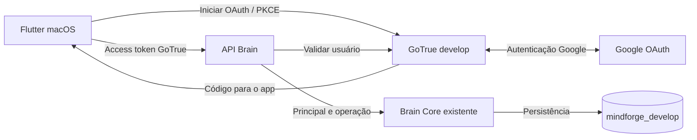

# Spec integrada aprovada: primeiro fluxo manual macOS

## Contexto e fontes

Owner escolheu a entrega conjunta Auth + API + Flutter e solicitou **planejamento apenas**. macOS, Google OAuth como único método de entrada e TDD `yes` estão confirmados. O pedido posterior de execução aprovou o desenho/contratos e a implementação local até o limite das credenciais; a seção de autorização atual governa esta execução. [Discovery](discovery.md) preserva a investigação e suas fontes.

Brain Core r4 permanece a autoridade do domínio. Reutilizar `Bootstrap`, `Observe`, `CreateLayer`, `RenameLayer` e `PostgresStore`; develop já tem schema0006 e prova comportamental. Não confundir isso com API ou client entregues. Monorepo único, componentes independentes e dirty work preservado.

## Objetivos

- App Flutter macOS online com entrar/sair pelo Google, restauração segura da sessão e abertura do Brain privado.
- Primeira entrada inicializa o Brain sem camadas visíveis; usuário pode consultar a árvore, criar camadas/subcamadas e renomear com conflito explícito.
- Integrar identidade → API → Engine → PostgreSQL do develop, provando isolamento entre usuários e ambientes.
- Fechar contratos compartilhados antes de desenvolver produtor e consumidor em paralelo.

## Não objetivos

Senha própria, cadastro/recuperação por email, SMTP, Firebase, outros provedores; agentes/LLM, Inbox, documentos, Hive Mind, mover/excluir camadas, offline/sync; promoção/main, alteração NSR/Studios, publicação Internet/App Store/notarização, instalação de Xcode/aceite de licença ou deploy nesta sessão. Não criar outra implementação das regras do Brain Core nem acrescentar migration de idempotência por inferência.

## Desenho e caminhos de execução

### Fluxo de produto e identidade

1. App restaura sessão armazenada ou oferece **Entrar com Google**. Google autentica a conta; GoTrue develop emite a sessão Mindforge. O primeiro acesso OAuth pode criar o usuário no Auth; abrir o workspace inicializa o Brain de modo idempotente.
2. Client usa o access token **GoTrue**, nunca token Google, credencial DB ou chave administrativa para a API Brain.
3. Proposta para o primeiro verificador: API consulta `GET /user` do GoTrue develop por endpoint interno fixo e envia o Bearer recebido. Não decodifica JWT sem verificar, não usa email como owner e não recebe `Principal`/target do client.
4. Aceitar somente resposta Auth200 válida com ID de usuário, `aud`/role `authenticated`, conta confirmada e identidade Google; negar identidade anônima/não elegível. Derivar `Principal` do ID autoritativo retornado pelo Auth. Verificação de assinatura/expiração pertence ao GoTrue consultado; esta proposta não cria verificador JWT local paralelo.
5. Falta/token inválido ou rejeição Auth→401 **antes de chamar Engine**. Auth indisponível, timeout, redirect ou resposta incompatível→503, sem efeitos. Endpoint Auth fixo em configuração privada, sem follow de redirects nem URL fornecida pelo solicitante. Timeout candidato3s; sem cache positivo de identidade nesta entrega.
6. Ambiente do servidor e DB são fixos develop; startup faz probe read-only de `current_database()` antes de abrir o Store e recusa main/target divergente. Não aplicar migrations no startup.

Google é o provedor externo; Supabase/GoTrue continua emissor da sessão. Não migrar identidades para Firebase. Propor desativar entrada email/senha e anônima somente no Auth develop, mantendo configuração Google explícita. Sem excluir usuários existentes; validar o efeito das flags na versão2.196.0 antes de qualquer operação. Tokens já emitidos não são prometidos como instantaneamente revogados pela mudança de configuração/logout.

### OAuth privado e configuração futura

- OAuth client Google do tipo **Web application**, consentimento/escopos básicos e callbacks exatos; client secret somente na configuração privada do Auth. Escopos de identidade básicos (`openid`, `email`, `profile`), sem APIs Gmail/Drive/Calendar ou armazenamento de refresh token Google.
- Duas etapas distintas: Google retorna ao GoTrue; GoTrue retorna ao app com código que o SDK troca usando PKCE. Browser externo; não WebView de credenciais nem implementação manual de criptografia OAuth.
- Candidato de desenvolvimento privado: Mac loopback Auth `http://127.0.0.1:11000` e Brain `http://127.0.0.1:11001`, encaminhados por SSH para loopback10000 e18087 da VM, respectivamente. Túnel é setup operacional externo ao app; host/porta SSH ficam em config privada. Não colocar shell SSH ou senha dentro do Flutter.
- Callback Google candidato `http://127.0.0.1:11000/callback`, pois GoTrue aqui é direto, sem gateway `/auth/v1`. Confirmar path e URI exata na configuração e versão reais antes de registrar no Google. Não copiar callback da stack Supabase completa.
- Callback final candidato `mindforge-dev://auth/callback`, permitido exatamente no Auth e registrado no Runner macOS. Validar scheme/host/path, tentativa PKCE pendente e troca pelo SDK; negar callback inesperado, erro/código expirado ou sem verifier. Cancelamento volta ao login sem bootstrap.
- Ports/scheme/identificador de bundle são valores candidatos a congelar na implementação autorizada. Se ocupados/incompatíveis, reconciliar todos os callbacks/configs juntos, sem fallback silencioso para main.
- Configuração OAuth em arquivo privado separado e overlay **somente auth-develop**. O parser do operador infra tem allowlist de keys: não inserir Google keys no `infra.env` nem invalidar sua configuração. Preservar DB URL, role e JWT develop; main/NSR intocados. Nunca usar `up.sh` global para essa entrega.
- O acesso público HTTPS é alternativa futura; não será introduzido para resolver o develop por inferência.

### B01 — Configurar o projeto e as credenciais Google OAuth

Esta é uma etapa obrigatória do processo, explicitada pelo owner em08/10/2026. Executá-la no início do setup futuro, após autoridade específica para os efeitos Google Cloud. Nesta revisão foi somente planejada.

1. **Acesso e projeto:** owner escolhe a conta Google responsável e confirma acesso ao Google Cloud Console. Selecionar um projeto de desenvolvimento existente apropriado ou criar um para Mindforge develop, registrando responsável e referência do projeto em inventário privado. Não reutilizar credenciais de produção ou configurar main nesta unidade.
2. **Branding:** em Google Auth Platform, configurar nome de apresentação `Mindforge develop`, email de suporte e contato do responsável. Esses emails são metadados do OAuth, não configuração SMTP.
3. **Audience:** a experiência desejada é login Google normal, sem cadastramento manual de emails como requisito. Planejar público External para contas Google fora de uma organização única. Com apenas os escopos básicos de identidade, Google documenta exceção ao modo Testing: a lista de testadores não é necessária. Definir duas contas Google reais para provar isolamento não significa cadastrá-las em uma allowlist. Mudanças de publicação no console não são feitas por inferência; conectividade privada e permissões Brain continuam separadas do público OAuth.
4. **Data Access:** selecionar somente identidade básica (`openid`, email e perfil), conforme os escopos do provedor. Nenhuma permissão Gmail/Drive/Calendar será pedida.
5. **Congelar endereços:** fechar porta local, callback Google→GoTrue e callback GoTrue→app junto do contrato técnico. Candidatos desta spec: `http://127.0.0.1:11000/callback` e `mindforge-dev://auth/callback`. O primeiro entra nas Authorized redirect URIs do Google; o segundo entra no allowlist GoTrue e no registro macOS. Confirmar a rota direta do GoTrue antes de cadastrar o callback; os valores ainda não foram testados.
6. **Clients:** criar um OAuth client do tipo **Web application** para develop. GoTrue intermedeia a troca com Google e guarda o segredo; a interface ser macOS não muda esse tipo neste desenho. Não substituir por API key ou service account. Authorized JavaScript origins só serão preenchidas se a integração realmente exigir origem Web; este client nativo usa browser externo e redirect.
7. **Obter as credenciais:** guardar `Client ID` e `Client Secret` na criação em local privado, com acesso restrito, fora do Git/pacote/chat/logs. O processo não pede ao owner que cole o segredo em uma mensagem. Registrar a existência/identificação lógica da credencial e local seguro, sem registrar seu valor na evidência.
8. **Preparar o handoff ao Auth:** mapear as credenciais no arquivo privado separado da unidade para `GOTRUE_EXTERNAL_GOOGLE_CLIENT_ID`, `GOTRUE_EXTERNAL_GOOGLE_SECRET`, `GOTRUE_EXTERNAL_GOOGLE_REDIRECT_URI` e habilitação `GOTRUE_EXTERNAL_GOOGLE_ENABLED`. Não colocar client secret, JWT secret ou credencial administrativa no Flutter. A aplicação dessas variáveis/overlay somente no Auth develop é B04, com autoridade VM própria; não executar restart agora.
9. **Verificar configuração documental:** tipo do client, projeto/público de desenvolvimento, escopos, callback exato e segredo guardado devem estar completos. Essa checagem libera o setup Google para integração, mas não marca OAuth runtime como verificado.
10. **Prova real em B04:** após serviço/callback/túnel/app prontos, owner autentica no navegador; confirmar Google→GoTrue→app, sessão GoTrue, acesso do próprio Brain e isolamento de dois usuários. Não considerar a mera obtenção das chaves como login funcional.

Saída esperada do setup Google: projeto e responsável definidos, consentimento configurado, credencial Web develop criada e armazenada privadamente, callbacks acordados e inventário sanitizado. Sem segredo Google no aplicativo e sem criação de recursos externos nesta sessão.

Referências: [Google Auth Platform](https://support.google.com/cloud/answer/15544987?hl=en), [Audience e exceções de Testing](https://support.google.com/cloud/answer/15549945?hl=en), [configuração Google no Supabase](https://supabase.com/docs/guides/auth/social-login/auth-google), [variáveis GoTrue self-hosted](https://supabase.com/docs/guides/self-hosting/self-hosted-oauth).

### Contratos HTTP aprovados para implementação local

Fontes canônicas: [registry](../../../../contracts/openapi/registry.yaml) e [OpenAPI aprovado](../../../../contracts/openapi/brain-core.openapi.yaml). Runtime dessas operações continua pendente. Auth upstream é consumo de protocolo GoTrue existente; não copiar suas rotas como endpoints novos do Brain.

| Operação | Método/path propostos | Entrada | Sucesso | Semântica |
| --- | --- | --- | --- | --- |
| Inicializar próprio Brain | `PUT /v1/me/brain` | Sem body |200, BrainEnvelope | Bootstrap convergente; mesma resposta estrutural em primeira/repetida chamada |
| Observar | `GET /v1/me/brain` | Sem body |200, HierarchyEnvelope | Somente leitura;404 se ainda não inicializado |
| Criar camada | `POST /v1/me/brain/layers` | `{parent:{kind,id},name}` |201, LayerEnvelope | Parent root/layer no próprio Brain; novo ID |
| Renomear camada | `PATCH /v1/me/brain/layers/{layer_id}` | `{name,expected_version}` |200, LayerEnvelope | CAS; versão antiga409 |

DTOs candidatos: BrainEnvelope=`{brain:{id,root:{kind:"root",id}}}`; HierarchyEnvelope acrescenta `layers:[]`; LayerEnvelope=`{layer:{id,parent:{kind:"root"|"layer",id},name,version}}`. Root fica separado e não entra em layers. IDs são strings opacas no client; não nomes/paths. `version` é inteiro positivo compatível com bigint, e a versão esperada deve estar entre1 e9223372036854775807. Preservar acentos, case e duplicidade de nomes; normalização autoritativa pelo Engine.

JSON estrito: não aceitar owner, target, campos desconhecidos ou tipos incorretos. GET/PUT sem body; POST/PATCH JSON. Guardrail HTTP candidato1MiB por body, sem criar limites de níveis de produto. Ordenação das layers não expressa posição autoritativa; seleção e expansão da árvore usam IDs.

Erro candidato `{error:{code,message},request_id}` sem nomes/IDs/dados de outro usuário, SQL ou detalhes Auth.400 `invalid_request`;401 `unauthenticated`;404 `not_found` para ausência/outro owner;409 `conflict`;422 `invalid_name`;500 `internal`;503 `auth_unavailable`.405/413/415 para falhas de protocolo. `ErrForbidden` e `ErrNotFound` devem ter a mesma resposta404. Não retornar versão/identidade do recurso estrangeiro no erro.

### Flutter, sessão e falhas

- Propor Flutter/Dart com Views/ViewModels e Services/Repositories pequenos; DI por construtores e estado nativo Flutter. Não adicionar framework de estado ou gerar toda a arquitetura futura.
- Propor `gotrue` standalone (versão pesquisada2.27.2), `http`, `url_launcher`, `app_links` e `flutter_secure_storage`; pin/lock e compatibilidade do SDK devem ser conferidos antes de adoção. Auth direto pede URL raiz; `supabase_flutter` exigiria contrato de gateway/chave adicional e não é plug-and-play no Compose atual.
- SDK faz PKCE/refresh. Keychain para sessão e verifier temporário, em namespaces separados por app/ambiente/origem. Storage de PKCE não é persistência automática da sessão. Recuperar sessão pelo SDK e ouvir eventos/erros; persistir apenas dados necessários da sessão GoTrue, excluindo provider tokens Google. Sem tokens em prefs, logs, URLs de API ou Git.
- Login/loading, consentimento negado/cancelado, callback inválido, restauração, refresh indisponível e sessão expirada são estados explícitos. Erro temporário de rede não deve apagar sessão válida; falha definitiva de credencial remove storage/sessão/árvore.
- Logout limpa estado/Keychain/verifier deste app, invalida operações pendentes da sessão e tenta `signOut(scope:local)` no Auth. Falha de rede não conserva login local; não prometer revogação remota concluída. Access token já emitido pode durar até expirar. Novo usuário jamais vê estado da sessão anterior.
- Workspace: árvore com root oculto, estado vazio com criar primeira camada, seleção por ID, formulário/modal de criação com parent explícito, edição de nome e ação sair. Nada de editor documental/gráfico universal.
- Após login válido: PUT bootstrap e GET hierarquia; refetch após efeitos confirmados. Sem mutação otimista autoritativa. Nome vazio pode ter feedback local; servidor continua autoridade.
- Criação: somente um envio em voo por formulário; **sem retry automático de timeout/5xx/transporte**. Se resposta se perder, apresentar resultado incerto e reler árvore. Não deduplicar por nome ou assumir que a nova linha é a resposta daquele pedido. Nova criação só por decisão explícita do usuário.
- Rename: enviar versão observada.409 preserva rascunho e relê estado; usuário decide reaplicar sobre versão atual. Timeout exige releitura, sem sobrescrever nem declarar confirmação pelo nome coincidente.
-401 definitivo anterior ao Engine permite refresh serializado uma vez e reenvio limitado; nova rejeição encerra sessão. Não generalizar isso para requests sem resposta. Respostas tardias de outra geração de sessão são descartadas.
- Sem rede: informar indisponibilidade e impedir escrita; nenhum cache de Brain autoritativo/offline ou fila local de efeitos. Árvore recebida incompatível/cíclica não pode travar renderização nem ser apresentada como válida.

### Etapas e dependências

Uma spec por este fluxo; os lotes abaixo são ownership/ordem interna, não contratos independentes nem uma obrigação de três specs.

| Lote futuro | Trabalho | Dependência e saída |
| --- | --- | --- |
| B01 — Contrato e setup Google | Aprovar contrato/OpenAPI; conferir toolchain; configurar projeto, consentimento, escopos básicos, OAuth Web client, Client ID/Secret e callbacks segundo a seção B01 | Contrato congelado libera código B02/B03 contra fakes; setup Google autorizado e documentado é pré-requisito de B04 |
| B02 — Auth/API Go | Fronteira Auth → Principal, DTOs/handlers das quatro operações e composition root com Store existente; adaptar guarda legado de registry vazio ao novo contrato | B01; testes TDD de segurança/contrato green e binário Linux; nenhum novo SQL |
| B03 — Flutter macOS | Projeto independente; OAuth/Keychain/callback e workspace manual contra contrato e fakes | B01; pode correr junto com B02 em ownership distinto; testes/analyze/build após setup autorizado |
| B04 — Integração develop | Preparar operação externa concreta; configurar Google/Auth develop/túnel; entregar somente API develop; validar app real | B02+B03 verdes, Google Cloud/SDK prontos e autorização externa específica; prova fim a fim |

B01 tem duas saídas: contrato técnico congelado e setup Google concluído. A primeira libera B02/B03 contra fakes; a segunda é obrigatória antes de B04. A criação/configuração Google Cloud pode ocorrer em paralelo ao código, se autorizada, sem fingir que credenciais existem. B02/B03 podem avançar em paralelo somente depois dos contratos aprovados. Configuração infra de Auth e composição compartilhada têm um owner único; root integra. B04 não começa com um mock aceito como prova de serviço. Execução local agora autorizada; setup Google e integração real ficam para depois.

### Arquivos e ownership futuros

| Raiz | Paths candidatos | Owner futuro | Limite |
| --- | --- | --- | --- |
| Mindforge | `docs/features/brain/manual-online/`, registry e OpenAPI após aprovação | principal | decisões/interfaces/evidência |
| Brain Engine | `auth/` | worker Auth | verificador GoTrue e teste; sem regras Brain |
| Brain Engine | `api/`, `cmd/brain-engine/` | worker API + composição do principal | handlers/DTOs/runtime; reutilizar feature brain |
| Brain Engine | `features/infra/auth-google-develop/` | worker infra | overlay/config example/runbook seletivos; sem main/NSR |
| Client | `src/mindforge-client/` | worker Flutter | projeto Flutter independente, auth/brain/viewmodels/views/test/macOS; nenhum Git aninhado |

Paths agora autorizados nos scopes locais registrados abaixo. Brain Core SQL/r4 não será reescrito. Se aparecer necessidade de alteração de domínio/migration, retornar ao owner com o impacto.

## Dependências e autoridade

- Prerequisito: develop-studio aplicado; evidência existente de Engine/DB. A decisão do owner sobre acesso aos Studios não verifica o fluxo OAuth futuro.
- Pré-requisitos futuros: OAuth client/consentimento Google/test users e credenciais privadas; Auth develop/config de callbacks; toolchain macOS/Keychain/URL scheme; binário/API e conectividade privada.
- Flutter/Dart localizáveis; Xcode completo/CocoaPods não confirmados, paths convencionais ausentes. Instalação/configuração de ferramentas e aceite de licença permanecem operações separadas.
- Agora autorizados pelo pedido posterior: contratos aprovados, implementação local, testes/builds e preparação de helpers sem credenciais. Resolver dependências locais necessárias; Google Cloud, instalação de Xcode/licença, SQL/VM/deploy, UI/browser QA, publicação e commit/push continuam fora desta execução.
- Futuro B04 requer operação concreta revisável: alteração somente Auth develop, novo serviço API develop e túnel local; criação de contas Google/Brains/camadas de teste identificadas e duráveis; participação do owner no consentimento Google. Sem autoridade implícita de produção.
- Rollback futuro de infra restaura configuração anterior Auth develop e remove apenas API/túnel novos; não apaga usuários, Brains, dados, schemas ou volume. Revogar credencial Google exige decisão específica; segredo nunca entra no pacote.

## Aceitação proposta

- [ ] Setup Google concluído: projeto/responsável, consentimento/público/scopes, OAuth Web client, Client ID/Secret privados e callbacks exatos; nenhum segredo em Git/Flutter.
- [ ] Google-only: entrar/cancelar/sair funciona; primeiro acesso cria conta/Brain uma vez, sem senha própria/SMTP.
- [ ] Callback Google chega ao GoTrue e callback final chega ao macOS; PKCE sem verifier/redirect inesperado é rejeitado.
- [ ] Sessão restaurada/renovada no Keychain; logout/troca de conta não deixam árvore ou respostas de outra sessão.
- [ ] API nega token ausente/forjado/expirado e Google token bruto; negativos de ambiente main/NSR são cobertos por fixtures locais. Auth indisponível não vira acesso autorizado. Não fazer login/criar usuários em main/NSR para essa prova.
- [ ] Principal vem só do Auth confiável; owner/target no body são rejeitados. Recurso alheio equivale a ausente, sem efeito/vazamento.
- [ ] Bootstrap repetido/simultâneo converge; GET não cria Brain; primeira árvore tem zero camadas e root interno.
- [ ] Criar na raiz e aninhado persiste; nomes repetidos e normalização do r4 preservados.
- [ ] Rename preserva ID/parent/filhos; CAS409 preserva edição e impede lost update.
- [ ] Criação sem resposta não é reenviada automaticamente nem deduplicada por nome; usuário recebe resultado incerto.
- [ ] App reiniciado mostra dados persistidos pelo Engine; sem acesso direto do client ao PostgreSQL.
- [ ] Prova real de dois usuários Google e isolamento em develop; main, NSR, Studios e volume preservados.

## Validação

- **Planejamento atual:** fontes locais/primárias, consistência dos quatro contratos/DTOs, paths relativos, status YAML, autoridade e ordem de dependências. Nenhum teste de código/runtime nesta unidade.
- **Local futuro:** TDD Go para verificador/handlers com Auth/Store fakes; Flutter unit/widget tests para estados/contratos; Go unit/race/vet e Flutter analyze/test/build macOS. HTTP test server/fakes não são DB descartável.
- **Runtime futuro:** só VM indicada com autorização; Auth/Google reais, API com token válido e negativo, Engine/PostgresStore no develop, app macOS e dois usuários. SQL somente na VM; nunca banco local/descartável.
- **Limites:** unit/widget/build não provam OAuth/callback/Keychain/DB; artefato de API não prova implantação; participação do owner no login e aceite do app é evidência identificada. Não iniciar visual/browser QA automaticamente. Não registrar conta, JWT, callback bruto, email pessoal, senha, IP da VM ou segredo em Git/evidência.

## Testes e TDD

Owner confirmou `yes` para esta nova unidade. Em cada lote de código futuro: red significativo → implementação mínima → green/regressão pertinente. Primeiro provar confiança da identidade/isolamento e invariantes HTTP; depois consumo e estados UI; por fim integração real autorizada. Executar o TDD da etapa local agora autorizada.

## Automação e scripts

Reusar pacote/hash e operações infra existentes quando compatíveis. Propor helper seletivo de release/API e helper de túnel somente se repetição/reprodutibilidade justificarem: inputs privados de endpoint/release, bind loopback, falha em conflito de porta, sem senha literal, sem instalação/SQL/restart main embutidos. CI/geração de client não são pré-requisitos desta primeira entrega. Nenhum script novo escrito agora.

## Riscos e decisões

- Acesso Google Cloud e ferramentas nativas ainda não comprovados. Configurar ambos cedo após autorização; não acumular UI pronta contra um login impossível.
- Callback em home.arpa não deve ser tratado como callback público Google; o candidato loopback+túnel resolve somente este Mac/dev. Publicar para outros usuários requer outro recorte operacional.
- Verificação Auth remota é proposta explícita: custo de uma chamada e dependência de disponibilidade. Não migrar silenciosamente para JWT local/cache; isso muda segurança e revogação.
- A guarda estática legada da infra exige `endpoints: []`. Como AGENTS permite propostas no registry, B02 deve corrigir essa premissa sem enfraquecer a exclusão de APIs de produto dentro da própria infra. Não ocultar uma falha nem modificar testes durante planejamento.
- Criação exatamente uma vez/idempotency key está adiada; sua introdução muda API/persistência e exige decisão. O fluxo atual é honesto sobre resultado incerto.
- Entradas email/senha discutidas inicialmente foram substituídas por Google-only. Não incluir telas/templates/SMTP nem Firebase como trabalho oculto.
- IDs privados sobrevivem ao rename; extensões de produto e alterações da migration0006 permanecem fora do recorte.

## Autorização de execução atual

Owner autorizou em08/10/2026: “show, então execute o planejamento ai, completo ate onde der sem as credenciais, ai depois que terminar ai a gente cria e cadastra, beleza?”. Isso aprova o desenho/contratos apresentados e a execução local B01 contratos+B02+B03, com preparação dos helpers de B04. Mantém Google Cloud/credenciais para depois; não autoriza VM/SQL/deploy/main/NSR, instalação de Xcode/aceite de licença, publicação, commit ou push. Dependências locais necessárias aos testes/builds podem ser resolvidas, dentro dos limites de permissão do host. Não oferecer login fictício nem trocar o Google-only por outro método.

Scopes executáveis: api_delivery owns `src/brain-engine/auth/`+`api/`; client_delivery owns `src/mindforge-client/`; infra_delivery owns `features/infra/auth-google-develop/`. Principal owns contratos/docs, `cmd/brain-engine/`, adaptação pontual do guarda registry na infra e integração. Root e folhas usam TDD; nenhuma folha cria subagentes. Nomes/callbacks congelados para develop: Auth `http://127.0.0.1:11000`, API `http://127.0.0.1:11001`, callback Google `http://127.0.0.1:11000/callback`, app `mindforge-dev://auth/callback`, bind API na VM loopback18087. O callback Google real ainda precisará ser comprovado após configurar o client.

## Aprovações históricas do planejamento

- Direção de produto/plano: opção2; macOS; Google OAuth único; TDD `yes`, confirmados na conversa de08/10/2026.
- Spec técnica e endpoints: **propostos**, aguardando discussão/aprovação do owner.
- Implementação: **não autorizada**; pedido explícito é planejamento apenas, mesmo com direção de produto aprovada.
- Owner pediu explicitamente incluir configuração Google e obtenção das chaves no processo; esta revisão detalha o planejamento de B01. Criar/configurar esses recursos externos ainda requer autoridade específica.
- Instalações/Google Cloud/VM/SQL/dados reais/release/publicação/commit/push: sem autorização nesta unidade.

## Execução e retomada

- [Checkpoint](manual-online-checkpoint.yaml); implementação local concluída sem credenciais. [Evidência](implementation-evidence.md) registra checks e limites. B01 contratos/B02/B03 código completos; Google B01 e integração B04 pendentes.
- Retomar no setup Google e na prontidão nativa macOS; B04 somente após credenciais/toolchain e operação externa autorizada. Não repetir implementação ou marcar runtime a partir dos mocks.
- [Discovery](discovery.md) registra fontes e workers; [evidência anterior de infra](../../infra/develop-studio/runtime-evidence.md) comprova apenas a fundação.

### Escolhas concretas da implementação local

SDK Flutter3.38.7/Dart3.10.7 existente mantido; app_links7.0.0 e url_launcher6.3.2 adotados com lockfile por compatibilidade, demais versões pesquisadas mantidas. Keychain single-app configurado com `usesDataProtectionKeychain:false`, sem grupos de compartilhamento/provisioning. Config do servidor exige owner/login `mindforge_develop`, hostdb:5432, schema existente e Auth interno develop. O build Flutter nativo está limitado por `xcodebuild` ausente; Google permanece não configurado. Contratos não mudaram nesses ajustes.

### Operação B04 preparada para autorização da VM

Owner forneceu Client ID e Client Secret Google. Valores salvos somente em configuração privada fora do Git, mode0600; validador local passou. Essa evidência confirma formato/binding, não validade no Google nem callback/login funcional.

Operação concreta proposta, ainda não aplicada:

1. Preflight read-only na VM: registrar IDs/startup/volumes de main/NSR/DB e Auth develop; confirmar aliases/rede, banco/role develop e portas10000/18087. Sem leitura de dados pessoais ou target NSR.
2. Entregar pacote Linux verificado em `/opt/mindforge/releases/manual-online-20261008-r2/`; conferir manifesto e binário SHA-256. Não substituir DB/infra existente.
3. Preparar `/etc/mindforge/manual-online/` (dir700/env600): Google env do arquivo privado local e runtime env derivado da credencial develop já instalada. Nenhum segredo em args, stdout, Git ou Docker build context.
4. Guardar configuração efetiva anterior do Auth develop privadamente. Renderizar/validar base infra + overlay Google sem imprimir valores, conferindo target e preservação de DB/JWT/volume. Aplicar apenas `-p infra ... up -d --no-deps auth-develop`; não usar `up.sh`, serviços DB/main/NSR ou migrations.
5. Construir/subir somente o novo projeto `mindforge-brain-engine-develop`, porta18087 loopback, rede existente, binário não-root; startup só consulta catálogo read-only e abre o Store. Não criar DB/role/schema/volume.
6. Abrir túnel SSH local11000→Auth10000 e11001→API18087 com host key estrita/config privada; não modificar DNS/Nginx nem expor serviço na Internet.
7. Verificar saúde Auth, providerGoogle habilitado e início do redirect OAuth, sem exibir Location bruto/tokens; API sem credencial401; main/NSR/DB/Studios e volume preservados. Isso não marca as quatro operações como runtimeverified.
8. Callback/login no aplicativo e API autenticada ainda dependem de Xcode/app nativo e consentimento humano. Criar usuários/Brains/camadas duráveis para prova real requer escopo e autorização explícitos; não simular login real nem apagar dados no rollback.

Rollback de serviço: parar só a API nova/túnel e restaurar configuração anterior do Auth develop se falhar; nunca apagar DB/usuário/Brain/volume. Nenhuma etapa acima executada apenas pelo recebimento das credenciais. Instalação Xcode/licença continua separada.

### Esclarecimento: acesso Google sem lista manual de emails

Owner esclareceu que não pretende depender de cadastro manual de emails/testadores. A intenção permanece login normal com conta Google e criação da conta Mindforge no primeiro acesso. O [Google documenta a exceção](https://support.google.com/cloud/answer/15549945?hl=en) para nome/email/perfil, inclusive no modo Testing. O [GoTrue2.196.0](https://raw.githubusercontent.com/supabase/auth/v2.196.0/internal/api/provider/google.go) usa email/perfil por padrão, e o client não acrescenta scopes de APIs Google. O aviso genérico do console não é prova de que este fluxo exija allowlist. Escopos efetivos e comportamento serão conferidos na integração real; nenhum ajuste de console/VM foi executado por esta explicação.

### Autorização de aplicação B04

Owner respondeu ao pedido concreto de aplicação Auth develop/API VM/túnel: “beleza temos então o oauth configurado eu acho ne? podemos prosseguir?”. Isso autoriza os passos1–7 da operação preparada. Cadastro Google feito pelo owner e configuração privada recebida; alterações em main/NSR, instalação Xcode/licença, publicação e criação de dados de usuários reais para prova completa não são inferidas. O passo8 permanece dependente do app nativo e consentimento do owner.

### Resultado da aplicação B04 de serviços

Auth develop/API e túnel aplicados; [evidência real](runtime-service-evidence.md) registra provider/redirect/scopes, rejeição401 e preservação. Sem login Google concluído ou app nativo; `runtime_status` dos endpoints permanece pending. Próxima etapa é toolchain macOS e prova autenticada, não repetir deployment.

### Pausa e próxima direção escolhida pelo owner

Owner recusou o custo de armazenamento do Xcode e pediu encerrar por hoje, retomando depois com build Android. Não instalar/configurar Xcode. A especificação macOS acima registra a entrega feita e sua limitação; não é mais o destino escolhido para a próxima prova. Android precisa de recorte atualizado na retomada (runner, toolchain, storage, callback e caminho de rede), sem alterações agora nem troca de OAuth/Backend por inferência. Auth/API develop na VM preservados; túnel local encerrado enquanto o trabalho está pausado.

## Continuação web autorizada em2026-10-09
Owner substituiu Android por web e autorizou build/Docker na VM. Estado atual em [web-local](../web-local/web-local-checkpoint.yaml); serviçosweb publicados, loginhumano/endpointsauthentificados pendentes. Xcode/Android deixam de ser bloqueio da entrega atual.
